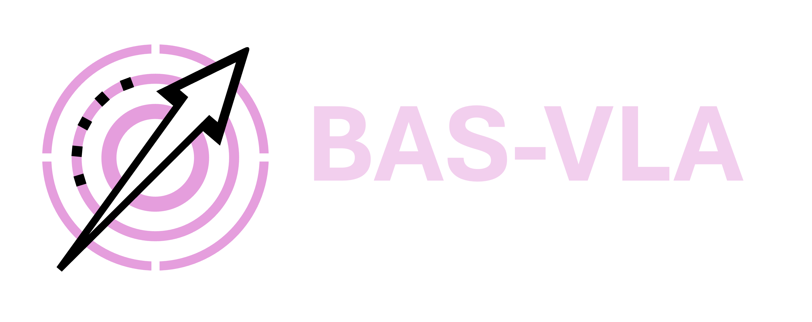

<div align="center">
  <picture>
    <source media="(prefers-color-scheme: dark)" srcset="docs/logo/logo_for_light_background.png">
    
  </picture>
  <h1>Beyond Appearance Shifts:<br>Task-Semantic Action Calibration for VLA Models</h1>
  <p><strong>NeurIPS 2026</strong></p>
  <p>
    <a href="https://arxiv.org/abs/2609.23650"></a>
    <a href="https://nebulis-lab.com/BAS-VLA/"></a>
    <a href="#getting-started"></a>
    <a href="https://huggingface.co/Shuaijun/BAS-VLA"></a>
    <a href="LICENSE"></a>
  </p>
</div>

## Overview

**When should a robot keep its behavior stable, and when should it change?** BAS-VLA calibrates the actions of a frozen vision-language-action policy under two types of intervention:

- **Task-preserving changes:** appearance or wording changes while the intended task stays the same.
- **Semantic-breaking changes:** the target, destination, relation, or constraint changes, requiring a different action.

The method combines a **breaking-centered residual calibrator**, trained on matched clean/control/break triplets, with a **selective preserving auxiliary** that uses a task-aware visual probe and evidence-gated weak fusion.

## Release scope

This repository releases code and methods for **a selected subset of the settings described in the paper**. It includes residual-calibration training, selective preserving probes, and evaluation utilities for the supported carrier and task configurations. See the [supported settings and evaluation setup](docs/reproduction.md) for the included entry points and their required inputs, and the [paper](https://arxiv.org/abs/2609.23650) for experimental results.

The same code is available in [Beyond-Appearance-Shifts](https://github.com/NEBULIS-Lab/Beyond-Appearance-Shifts) and [BAS-VLA](https://github.com/NEBULIS-Lab/BAS-VLA).

## Repository contents

| Component | Location |
| --- | --- |
| Residual calibrator, training objective, checkpoint I/O | [`bas_vla/breaking/`](bas_vla/breaking/) |
| Visual probes, GroundingDINO/SAM2 backends, gate, and fusion | [`bas_vla/preserving/`](bas_vla/preserving/) |
| Carrier and LIBERO integration helpers | [`bas_vla/runtime/`](bas_vla/runtime/), [`bas_vla/integrations/`](bas_vla/integrations/) |
| Dual-goal, external-protocol, and ordered-goal evaluation | [`bas_vla/evaluation/`](bas_vla/evaluation/) |
| Wilson intervals, gate/mask diagnostics, and latency summaries | [`bas_vla/analysis/`](bas_vla/analysis/) |
| Robot action interface and trial annotations | [`bas_vla/deployment/`](bas_vla/deployment/) |
| Training and evaluation command-line tools | [`scripts/`](scripts/) |
| Task configurations and campaign launchers | [`configs/`](configs/), [`launchers/`](launchers/) |
| Minimal carrier examples | [`examples/`](examples/) |
| Paper PDF, project page, and visual assets | [`docs/`](docs/) |

The carrier runners support **Frozen / Core / Pres / Full** modes, including residual-checkpoint loading, explicit frozen-feature inputs, and per-chunk traces. Evaluation tools cover dual-goal outcomes, norm-matched random controls, external protocol manifests, and order-sensitive goals.

Provide the carrier weights and a compatible adapter with its metadata and instruction-feature configuration before evaluation. Configure task assets and initial states for the selected setting; training also requires matched triplet records. Robot deployment requires a hardware backend and calibration. See the [setup guide](docs/reproduction.md) for details.

## Released artifacts

The [Hugging Face repository](https://huggingface.co/Shuaijun/BAS-VLA) provides an OpenVLA residual adapter with its vocabulary, action-normalization metadata, and matched LIBERO training records. The checkpoint is paired with the supplied OpenVLA action-calibration setting. See the [download and loading guide](docs/artifacts.md) for the files and usage.

## Getting started

### 1. Install the package

Use Python 3.10 or newer. Install the model and benchmark runtimes needed for your chosen carrier in a compatible environment, then install this repository:

```bash
python -m venv .venv
source .venv/bin/activate
python -m pip install -r requirements.txt
python -m pip install -e .
```

`requirements.txt` lists the common Python dependencies. OpenPI, OpenVLA-OFT, LIBERO, their simulator dependencies, and model checkpoints must be installed separately; the environment variables below point to those installations.

### 2. Configure and export runtime paths

```bash
cp .env.example .env
# Edit .env to point to your local repositories and checkpoints.
set -a
source .env
set +a
```

The scripts read environment variables; they do not automatically load `.env`. Export them in each new shell before using the runners.

| Carrier | Required variables |
| --- | --- |
| OpenPI + LIBERO | `BAS_OPENPI_ROOT`, `BAS_LIBERO_ROOT`, `BAS_OPENPI_CHECKPOINT` |
| OpenVLA-OFT + LIBERO | `BAS_OPENVLA_OFT_ROOT`, `BAS_OPENVLA_OFT_CHECKPOINT` |

See [`.env.example`](.env.example) for optional LIBERO configuration, dataset, and dependency paths. The helper below reports configured paths and whether Transformers can be imported:

```bash
python scripts/check_runtime_env.py
```

### 3. Run a carrier example

These examples exercise the carrier integrations with small rollout budgets:

```bash
# OpenPI + LIBERO: a clean-instruction carrier rollout.
bash examples/run_openpi_semantic_break.sh

# OpenPI + LIBERO: an appearance-shift carrier rollout.
bash examples/run_openpi_appearance_shift.sh

# OpenVLA-OFT + LIBERO: baseline clean/control/break evaluation.
bash examples/run_openvla_oft_semantic_break.sh
```

For larger condition matrices, see the [launcher documentation](launchers/README.md). Configure the task selection, seeds, and rollout budget for the evaluation you want to run.

### 4. Evaluate a calibrated policy

A core rollout loads the adapter and its matching metadata/vocabulary:

```bash
python scripts/eval_openpi_libero.py \
  --mode core --suite libero_object --task-ids 7 \
  --residual-checkpoint /path/to/residual_adapter.pt \
  --residual-metadata /path/to/adapter_metadata.json \
  --residual-vocab /path/to/vocab.json \
  --num-trials-per-task 50 --seed 7 \
  --output-dir runs/core
```

Metadata records the adapter's action space and layout. Pres and Full additionally require an explicit carrier feature provider and layer configuration. Full uses the calibrated action as its anchor; see [runtime modes and feature configuration](docs/runtime.md).

For changed-task completion, use [`eval_dual_goal.py`](scripts/eval_dual_goal.py). It checks new and old goals independently and records mutually exclusive outcomes. [Evaluation documentation](docs/evaluation.md) covers the task scenes, random controls, external benchmarks, and matched initial states.

### 5. Train a residual adapter

The trainer accepts a JSON list of matched clean/control/break records with `train` and `val` splits:

```bash
python scripts/train_breaking_adapter.py \
  --records-path /path/to/triplet_records.json \
  --config configs/training/paper_three_component.json \
  --carrier YOUR_CARRIER_CHECKPOINT_ID \
  --action-space libero_env --action-layout per_step \
  --action-normalization YOUR_ACTION_NORMALIZATION_ID \
  --device cpu --output-dir runs/breaking_adapter --seed 7
```

The public training recipe builds fixed bag-of-words instruction features. It saves weights, vocabulary, action/feature metadata, the full objective configuration, and training summaries. The three-component paper-form objective and the original extended objective are explicit presets. See [records, training, and checkpoints](docs/training.md) for the schema, synthetic format example, record exporter, and checkpoint inventory.

### Optional preserving probe

Set both `BAS_GROUNDING_DINO_MODEL_ID` and `BAS_SAM2_MODEL_ID` to enable the grounded probe, and select its device with `BAS_GROUNDED_DEVICE`. The selector can use the style probe when no grounded backend is configured; traces identify which probe ran. Carrier feature evidence and probe selection are configured separately.

## Documentation

- [Released artifacts and loading](docs/artifacts.md)
- [Intervention construction](docs/interventions.md)

- [Supported settings and evaluation setup](docs/reproduction.md)
- [Carrier modes, frozen features, and OFT style shifts](docs/runtime.md)
- [Dual-goal and external evaluations](docs/evaluation.md)
- [Training records and checkpoint metadata](docs/training.md)
- [Wilson intervals, gate/mask diagnostics, and timing](docs/diagnostics.md)
- [Matched strategy comparisons](docs/comparisons.md)
- [Robot interfaces and trial annotations](docs/robot.md)
- [Environment setup](docs/environment.md)
- [Script reference](scripts/README.md) · [Launchers](launchers/README.md) · [Examples](examples/README.md)

## Citation

```bibtex
@inproceedings{liu2026basvla,
  title     = {Beyond Appearance Shifts: Task-Semantic Action Calibration for VLA Models},
  author    = {Liu, Shuaijun and You, Feiyang and Wu, Chengyu and Hao, Shuyang and Zhang, Chenglong and Cai, Jingyao and Chen, Xingwei and Sun, Li and Su, Ningxin},
  booktitle = {Advances in Neural Information Processing Systems},
  year      = {2026},
  url       = {https://arxiv.org/abs/2609.23650}
}
```

## License

The code in this repository is released under the [MIT License](LICENSE). External runtimes, model weights, and datasets retain their respective licenses.
